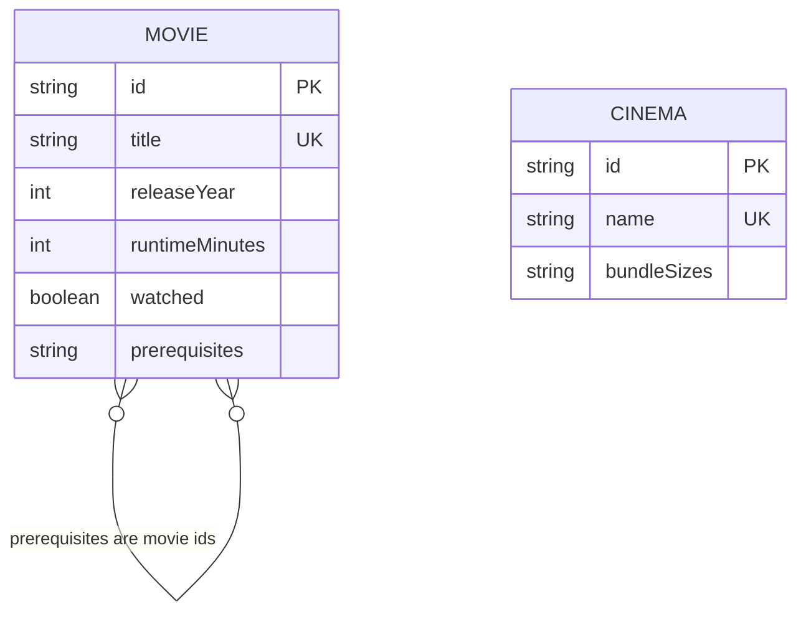

# Doomsday Ready

A small full stack app for MCU fans. Pick a movie and see every film you need to watch first, in a valid order, with watched progress and remaining watch time. Then book an opening night watch party by asking for the fewest cinema seat bundles that add up exactly to your group size.

Built with Next.js, the App Router, route handlers and React pages.

## Run it

```bash
npm install
npm run dev
```

Open http://localhost:3000. The same Next.js server serves the pages and the `/api` routes.

For a production run:

```bash
npm run build
npm start
```

Check every assessment requirement:

```bash
npm run build
node scripts/verify.mjs
```

Docker bonus:

```bash
docker compose up --build
```

On Vercel the app writes its JSON store to the system temp folder, so the API works at https://doomday-taupe.vercel.app. That storage is temporary and is not shared between server instances. Local runs keep using `data/store.json`. Set `DATA_DIR` if you want another folder.

## How AI was used

I used an AI assistant to plan the work, scaffold the Next.js project, write the React pages, and check the example results from the assessment brief. The two core algorithms, cycle detection in `lib/logic.mjs` and the bundle quote in the same file, are written directly with plain JavaScript. No library solves either feature. I verified the expected results from the brief by running the functions and by calling the live API.

## Choices where the brief was unclear

* The brief bounds runtime to 1 to 300 minutes but does not bound the release year. I accept a whole release year from 1888 to 2100.
* Prerequisites are stored as movie ids, so renaming a movie does not break links. Duplicate ids are ignored and unknown ids are rejected.
* A movie can depend on movies that are already watched. The rewatch plan still lists them and marks them as watched.
* For an equal number of bundles, the quote keeps the combination found first, with smaller sizes considered first. Any minimal combination is valid.
* Data lives in `data/store.json` locally and in the system temp folder on Vercel, created and seeded on first run. This keeps the assessment easy to run with no database setup.
* The sample movies and runtimes are from the brief table or reasonable placeholders. They are not an official watch guide.
* Avengers Doomsday is included as a movie with a sample runtime so a plan can be requested for it.

## Data model



`MOVIE.prerequisites` holds an array of movie ids. `CINEMA.bundleSizes` holds an array of seat counts.

## API

| Method and path | Purpose |
| --- | --- |
| `POST /api/movies` | Create a movie |
| `GET /api/movies` | List movies |
| `PATCH /api/movies/:id` | Update a movie, including watched and prerequisites |
| `GET /api/movies/:id/rewatch-order` | Rewatch order, watched count and remaining minutes |
| `POST /api/cinemas` | Create a cinema |
| `GET /api/cinemas` | List cinemas |
| `GET /api/cinemas/:id/booking?groupSize=6` | Fewest bundles for an exact group size |

Errors use a JSON body with an `error.code`. A cycle returns `409 CIRCULAR_DEPENDENCY`.

## How the logic works

* **Cycle check**: before a create or update, a depth first walk follows prerequisites from the movie being changed. If the walk reaches that movie again, the write is rejected with `409 CIRCULAR_DEPENDENCY`.
* **Rewatch order**: a depth first walk over prerequisites adds each movie after its prerequisites, using a visited set so each movie appears once. The target is never included.
* **Booking quote**: a dynamic program builds the best answer for every seat count up to the group size, keeping the number of bundles and one previous step. It then walks back to list how many of each size to buy. If the final count is unreachable, the answer is `possible: false`. Cost is group size times the number of bundle sizes, which is small for the given limits.

## Project layout

* `app/` pages and API route handlers
* `components/` the React app and browser API helper
* `lib/logic.mjs` the two hand written algorithms and input validation
* `lib/store.mjs` sample data and JSON file persistence
* `docs/scope/scope.md` the living build plan
